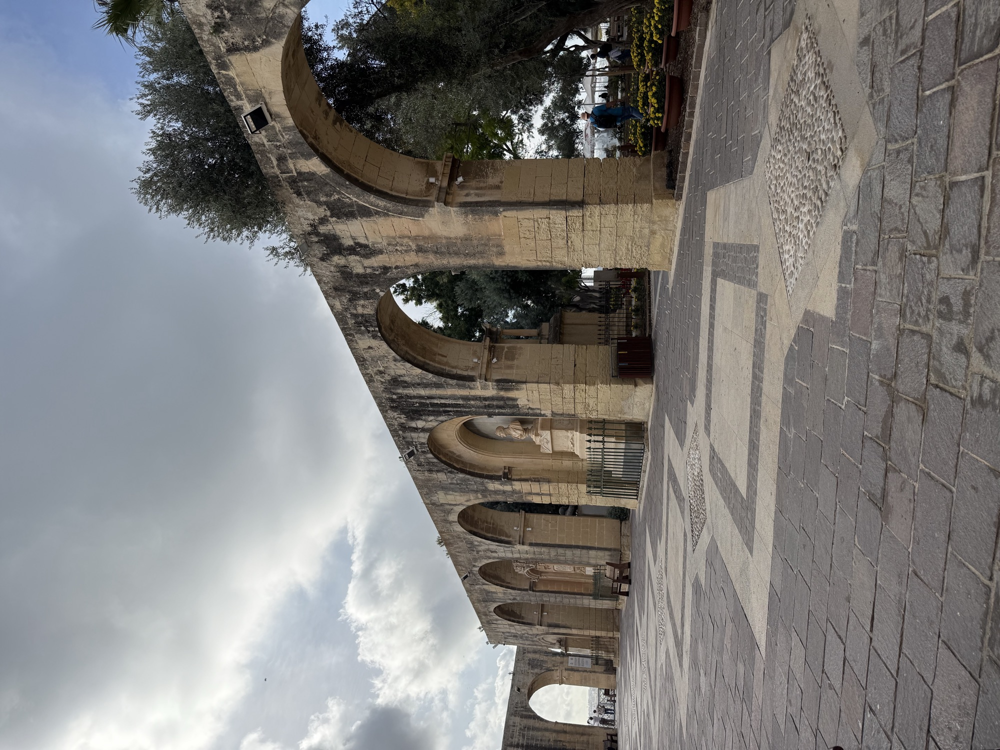

# Malta photos

Photos for the Malta post (`_drafts/malta.md`).

## Layout

```
assets/images/malta/
├── README.md
├── valletta/          # web-ready JPGs, committed and served by the site
│   └── IMG_XXXX.jpg
└── _originals/        # untouched iPhone HEICs, NOT committed or served
    └── valletta/
        └── IMG_XXXX.HEIC
```

- `_originals/` is listed in `.gitignore`, so it's never committed.
- Jekyll skips folders that start with `_`, so the originals don't end up in `_site`.

## Workflow for adding photos

1. **Drop** the iPhone HEICs into `_originals/<place>/`. Use a lowercase folder name, e.g. `_originals/mdina/`.
2. **Convert** them with the command below. It writes web-sized JPGs to `<place>/` and doesn't touch the originals.
3. **Add** an album for the place to the post under the right day (see [Adding to the post](#adding-to-the-post)).

`_originals/` is the source of truth. The JPGs in `<place>/` can always be regenerated from it.

## Conversion

The iPhone photos come off the phone as HEIC files of about 3–5 MB each. Not all browsers can show HEIC, and files that size would bloat the repo. So each photo is converted to JPG with `sips`, which comes with macOS:

- **Format:** HEIC → JPEG
- **Quality:** 80
- **Size:** longest side at most 2000px (`-Z 2000` keeps the aspect ratio)
- **Rotation:** kept, because the EXIF orientation tag carries over to the JPG
- **Filenames:** same as the original, with `.jpg` instead of `.HEIC`

For Valletta, 33 photos went from 112 MB (HEIC) to 33 MB (JPG).

### Command

Run this from `assets/images/malta/`, with `place` set to the folder name:

```sh
place=mdina
mkdir -p "$place"
find "_originals/$place" -maxdepth 1 -iname '*.heic' | while read -r f; do
  b=$(basename "${f%.*}")
  [ -e "$place/$b.jpg" ] && continue      # already converted
  sips -s format jpeg -s formatOptions 80 -Z 2000 "$f" --out "$place/$b.jpg" >/dev/null
done
```

You can safely re-run it. Photos that already have a JPG are skipped, so adding more photos to a folder later only converts the new ones. To regenerate everything, for example with different settings, delete the `<place>/` folder first.

## Adding to the post

The post has a `## Day N` heading for each day and a `### City` heading for each city, with images in the order they were taken (by filename):

Each group of photos goes inside `<div class="album">…</div>`. `assets/js/album.js` (loaded by `custom_js: [album]` in the post's front matter) turns it into a slideshow: one photo at a time, with **‹ Prev** / **Next ›** buttons and a `3 / 27` counter. If the script doesn't load, the album falls back to a strip you scroll left and right.

```html
<div class="album">

</div>
```

Use `mdls -raw -name kMDItemContentCreationDate <file>` to check a photo's capture date when deciding which day it belongs to.

## Before publishing

The JPGs are about 1 MB each. To shrink them further, delete the `<place>/` folders and re-run the conversion with `-Z 1600` and `formatOptions 70`. That should bring them to roughly 300 KB each.
